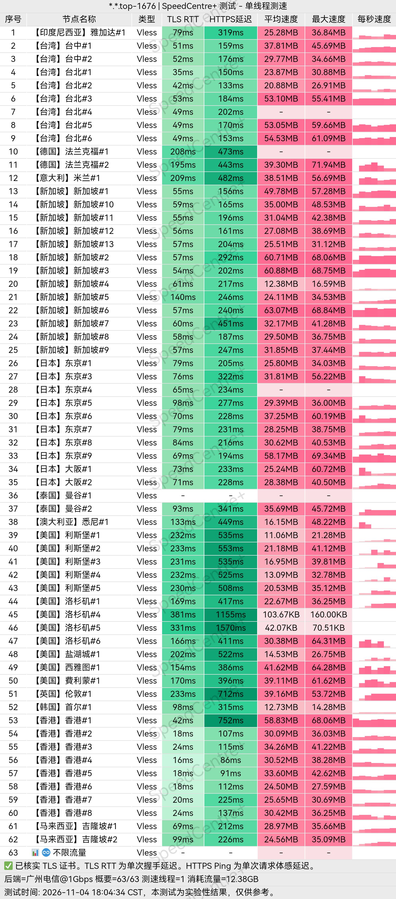
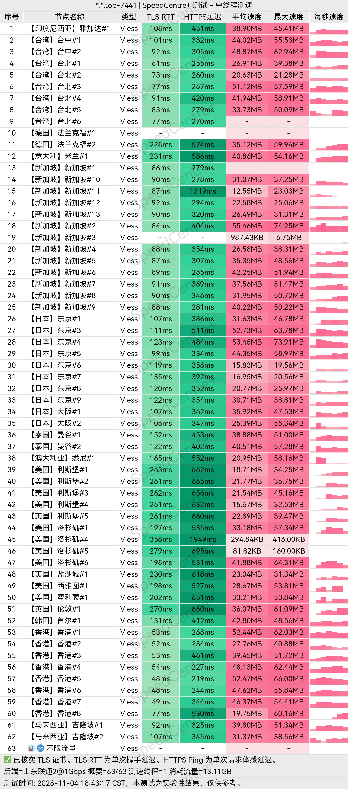
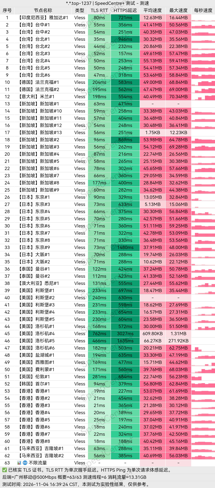
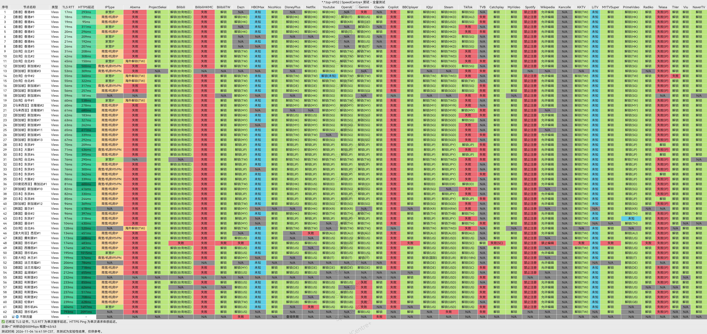
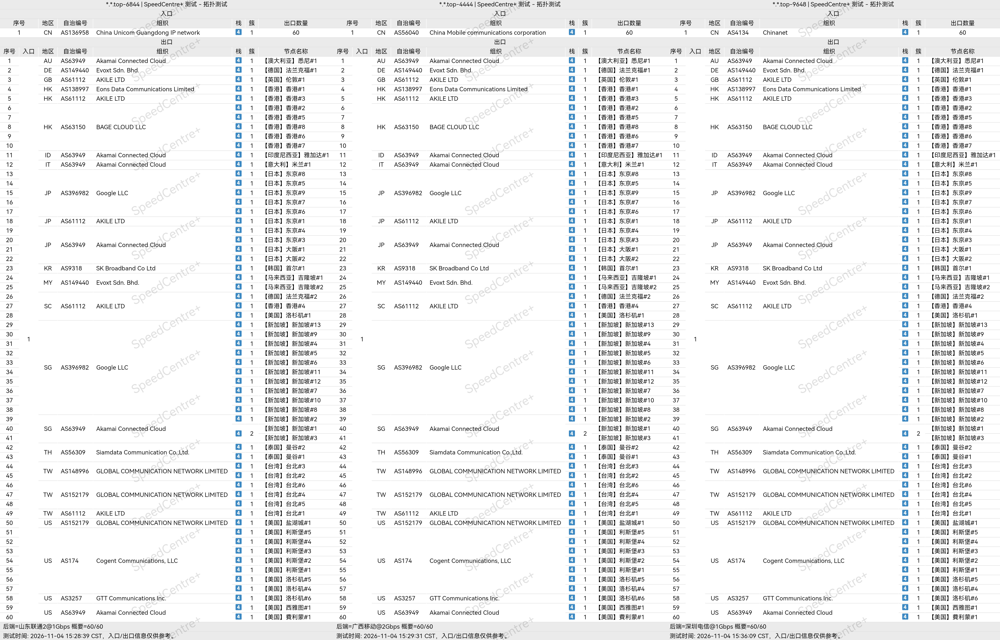

🇨🇳 中文 | 🇺🇸 [English](README_EN.md) | 🇷🇺 
[Русский](README_RU.md) | 🇮🇷 [فارسی](README_FA.md)

# DengTa 灯塔加速器机场官方地址(2026年11月11日更新)
DengTa 灯塔加速器机场官网地址</br>
最新地址：[www.dengta12.com](https://to.iix.im/dt01)</br>
官方地址：[www.dengta12.com](https://to.iix.im/dt01)</br>

2026最新好用的机场推荐与节点分享：[https://github.com/jdnei/JiChangTuiJian](https://github.com/jdnei/JiChangTuiJian)</br>
## Telegram VPN 机场福利社 #AD
[机场抽奖群](https://331024.de/archives/choujiang)｜[机场聊天群](https://331024.de/archives/choujiang)｜[机场体验群](https://331024.de/archives/choujiang)</br>

[https://331024.de/archives/choujiang](https://331024.de/archives/choujiang)
## 邀请码
```bash
H7KNKY
```
## 优惠码/折扣码
```bash

```
## 简介
Dengta（灯塔加速器）是一家主打企业级专线与智能网络加速的服务商，采用BGP及IEPL等优化线路，提供40多个全球节点，覆盖香港、日本、台湾、新加坡及欧美地区。支持Windows、macOS、iOS、Android、Linux及Apple TV，适合日常上网、影音娱乐、跨境办公和远程协作。
## 优势
灯塔加速器主打专线传输、智能选路及多入口容灾，官方客户端支持自动切换线路，并采用ML-KEM后量子加密技术。提供60GB至800GB多档套餐，支持3至10台设备同时在线。VIP及SVIP套餐流量用尽后降速不断网，另有条件退款、套餐升级及专属客服服务。
## 套餐
| 套餐 | 每月流量 | 同时在线设备 | 设备限速 | 线路类型 | 节点权限 | 订阅导出 | 退款保障 | 特色 / 备注 |
|---|---|---|---|---|---|---|---|---|
| 入门套餐 | 60GB / 月 | 3 台 | 未注明 | 普通专线网络 | 全平台所有节点 | 不支持 | 无退款保障 | 适合轻度使用，支持全平台客户端 |
| 轻量套餐 | 120GB / 月 | 5 台 | 200Mbps | 普通专线网络 | 全平台所有节点 | 仅年付用户支持 | 无退款保障 | 适合日常上网及多设备使用 |
| VIP 套餐 | 300GB / 月 | 8 台 | 300Mbps | 高级专线网络 | 全平台所有节点 | 季付及以上支持 | 24小时内，流量使用不超过10% | 适合高清流媒体及多设备用户 |
| SVIP 套餐 | 800GB / 月 | 10 台 | 500Mbps | 高级专线网络 | 全平台所有节点 | 季付及以上支持 | 24小时内，流量使用不超过10% | 适合重度用户及多设备高流量需求 |

## 📊 性能实测与分析
#### 1.1电信晚高峰测速表现
</br>
#### 1.2联通晚高峰测速表现
</br>
#### 1.3移动晚高峰测速表现
</br>
#### 2.流媒体解锁报告
</br>
#### 3.落地入口分析
</br>
